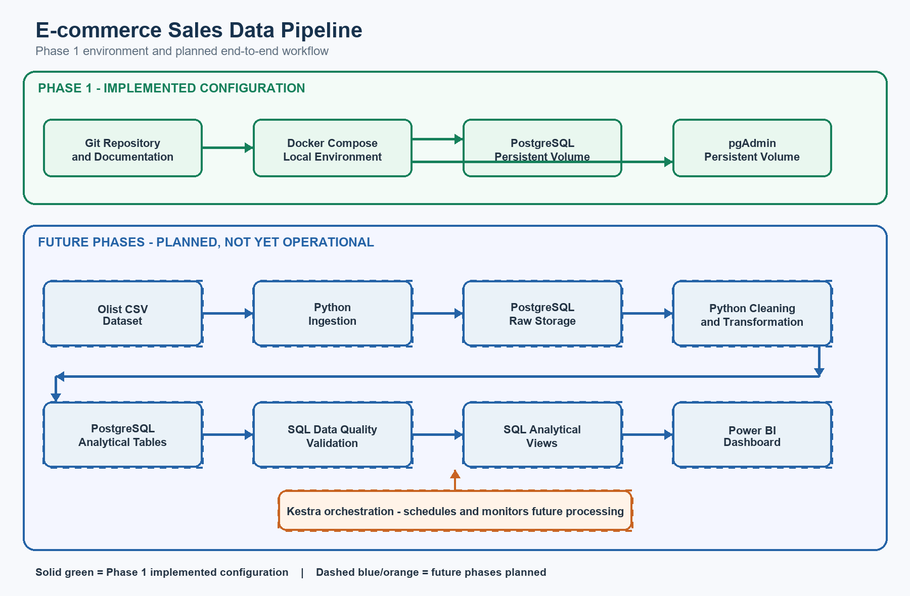

# E-commerce Sales Data Pipeline

Phase 1 university submission for a planned data engineering pipeline using the [Olist Brazilian E-Commerce Public Dataset](https://www.kaggle.com/datasets/olistbr/brazilian-ecommerce).

## Project overview

E-commerce data is distributed across orders, items, customers, products, sellers, payments, reviews, and locations. This project will ultimately extract, validate, clean, transform, and store those records in PostgreSQL for reliable reporting. Phase 1 establishes the proposal, conceptual architecture and database model, repository, and local PostgreSQL/pgAdmin environment. It does **not** implement ingestion, the star schema, Kestra flows, analytical views, or Power BI.

The official source files have now been inspected locally. The verified profile contains 99,441 orders, 112,650 order items, 99,441 customer records, 32,951 products, 103,886 payment records, 99,224 reviews, 3,095 sellers, 1,000,163 geolocation rows, and 71 category translations. Raw files remain excluded from Git; reproducible hashes and measured quality results are recorded in `docs/dataset_profile.md`.

## Analytical questions

1. Which product categories generate the highest sales revenue?
2. How do monthly sales revenue and distinct order volumes change over time?
3. Which Brazilian customer states contribute the most to total sales revenue?

Primary product-sales revenue is `SUM(order_items.price)`, excluding freight. Primary analysis includes delivered orders, counts orders with `COUNT(DISTINCT order_id)`, groups months by `order_purchase_timestamp`, and attributes geography to customer state. Payments are not directly joined to order items because both can contain multiple records per order.

## Architecture



Implemented in Phase 1: Docker Compose configuration, PostgreSQL, pgAdmin, persistent named volumes, repository structure, and documentation. The blue pipeline components and Kestra orchestration are future work. See `docs/architecture.md` and `docs/architecture.mmd`.

## Technology stack

| Technology | Phase 1 use | Status |
|---|---|---|
| Git/GitHub | Version control and collaboration | Local Git initialized; remote must be added |
| Docker Compose | Reproducible local services | Configuration and WSL 2 runtime validated |
| PostgreSQL 17.12 | Future raw and analytical data store | Container running and healthy; database query passed |
| pgAdmin 4 9.19 | Database administration | Container healthy; HTTP, login, server registration, and connection tested |
| Python | Future ingestion/transformation; Phase 1 read-only profiler | Verified source profile generated; ingestion not implemented |
| Mermaid | Architecture source | Diagram source supplied |
| Kestra | Future orchestration | Planned only |
| Power BI | Future dashboard | Planned only |

## Repository structure

```text
ecommerce-sales-pipeline/
|-- config/pgadmin/servers.json  # Default Docker server registration
|-- data/
|   |-- raw/                    # Local unmodified CSVs; ignored by Git
|   `-- README.md
|-- docs/
|   |-- proposal.md / proposal.pdf
|   |-- phase1_presentation_brief.md
|   |-- architecture.md / architecture.mmd / architecture.png
|   |-- database_design.md
|   |-- dataset_profile.md
|   |-- data_dictionary.md
|   |-- environment_validation.md
|   `-- phase1_video_script.md
|-- flows/README.md             # Reserved for later Kestra work
|-- scripts/
|   |-- profile_dataset.py
|   |-- generate_artifacts.py
|   |-- generate_presentation_brief.py
|   `-- README.md
|-- output/pdf/
|   `-- ecommerce_phase1_presentation_brief.pdf
|-- sql/README.md               # Reserved for later SQL work
|-- docker-compose.yml
|-- .env.example
|-- .gitignore
`-- README.md
```

## Prerequisites

- Git
- Docker Desktop with Docker Compose v2
- A browser for pgAdmin
- Python 3.10+ only when regenerating the dataset profile or documentation artifacts
- Kaggle account and accepted dataset terms to download the source data

Confirm Docker is running:

```bash
docker --version
docker compose version
docker info
```

## First-time environment setup

1. Clone the repository and enter its root.
2. Create a local environment file:

   **PowerShell**

   ```powershell
   Copy-Item .env.example .env
   ```

   **macOS/Linux**

   ```bash
   cp .env.example .env
   ```

3. Edit `.env` and replace both example passwords. Do not commit `.env`.
4. Validate and start the services:

   ```bash
   docker compose config
   docker compose up -d
   docker compose ps
   ```

5. Wait until both services show `healthy`. Inspect logs if needed:

   ```bash
   docker compose logs postgres
   docker compose logs pgadmin
   ```

## PostgreSQL connection

From a host database client:

| Setting | Value |
|---|---|
| Host | `localhost` |
| Port | `POSTGRES_PORT` from `.env` (default `5432`) |
| Database | `POSTGRES_DB` (default `ecommerce_db`) |
| Username | `POSTGRES_USER` (default `ecommerce_user`) |
| Password | `POSTGRES_PASSWORD` from `.env` |

Verify from inside the container without exposing the password:

```bash
docker compose exec postgres pg_isready -U "$POSTGRES_USER" -d "$POSTGRES_DB"
docker compose exec postgres psql -U "$POSTGRES_USER" -d "$POSTGRES_DB" -c "SELECT current_database(), current_user;"
```

If the shell has not loaded `.env` variables, substitute the configured values explicitly. With the `.env.example` non-secret names:

```bash
docker compose exec postgres psql -U ecommerce_user -d ecommerce_db -c "SELECT current_database(), current_user;"
```

## pgAdmin access

Open `http://localhost:5050` (or the configured `PGADMIN_PORT`) and sign in with `PGADMIN_DEFAULT_EMAIL` and `PGADMIN_DEFAULT_PASSWORD`.

A server named **E-commerce PostgreSQL (Docker)** is pre-registered with:

| Setting | Value |
|---|---|
| Host | `postgres` |
| Port | `5432` |
| Maintenance database | `ecommerce_db` |
| Username | `ecommerce_user` |
| Password | Enter `POSTGRES_PASSWORD` when prompted |

Inside Docker, pgAdmin must use host `postgres`, not `localhost`. The predefined registration reflects `.env.example`; if the database or username is changed, edit the server properties in pgAdmin. No database password is stored in version control.

## Verify the environment

```bash
docker compose config
docker compose ps
docker compose exec postgres pg_isready -U ecommerce_user -d ecommerce_db
docker compose exec postgres psql -U ecommerce_user -d ecommerce_db -c "SELECT datname FROM pg_database WHERE datname = 'ecommerce_db';"
docker volume inspect ecommerce_postgres_data
docker volume inspect ecommerce_pgadmin_data
```

In pgAdmin, expand the predefined server, enter the database password, open **Query Tool**, and run:

```sql
SELECT current_database(), current_user, version();
```

Do not report the pgAdmin browser check as successful until this query has actually run.

## Stop, preserve, or reset data

Stop containers while preserving both named volumes:

```bash
docker compose stop
```

Remove containers and network while preserving data:

```bash
docker compose down
```

Start again with the retained data:

```bash
docker compose up -d
```

To permanently reset both PostgreSQL and pgAdmin state, first back up anything important, then run the following **only with team approval**:

```bash
docker compose down --volumes
```

This destructive command is documented but was not executed during Phase 1.

## Dataset acquisition and profiling

Download the nine CSV files from the official Kaggle page and copy them unchanged to `data/raw/`. The files are ignored by Git. If Kaggle CLI is configured, a typical command is:

```bash
kaggle datasets download -d olistbr/brazilian-ecommerce -p data/raw --unzip
```

Never commit `kaggle.json`, tokens, or raw CSVs. Generate the verified local profile with:

```bash
python scripts/profile_dataset.py
```

On this workstation the command completed successfully against the official files. Other team members can compare the recorded SHA-256 hashes to confirm that they downloaded the same inputs.

## Current Phase 1 status

- Proposal Markdown and rendered PDF: complete.
- Concise four-page presentation and email PDF: complete.
- Architecture and conceptual database design: complete.
- Compose, PostgreSQL, pgAdmin, health checks, volumes, and network: configured and validated live.
- Local Git repository and initial commit: complete.
- Dataset profile: complete and verified against all nine official CSV files.
- Docker runtime validation: complete using Docker Desktop 4.99.0 with the WSL 2 backend; both services are healthy.
- Video: script and checklist complete; recording is a manual team action.
- GitHub publication: pending creation/connection of a remote and authenticated push.

## Publish to GitHub

Create an empty GitHub repository named `ecommerce-sales-pipeline` without adding a README, license, or `.gitignore`, then connect and push this existing local repository:

```bash
git remote add origin https://github.com/hossamadel7/ecommerce-sales-pipeline.git
git remote -v
git push -u origin main
```

If `origin` already exists but points to the wrong repository, inspect it first and then deliberately update it:

```bash
git remote -v
git remote set-url origin https://github.com/hossamadel7/ecommerce-sales-pipeline.git
git push -u origin main
```

Do not report the repository as published until the push succeeds and the files are visible on GitHub.

## Future phases

Later phases will add source ingestion, raw storage, cleaning, the star schema, automated quality tests, Kestra orchestration, analytical views, and Power BI. None is falsely marked operational in this repository.

## Troubleshooting

### `docker` is not recognized

Install Docker Desktop, enable its Compose v2 plugin, restart the terminal, and verify `docker info` succeeds.

### Port 5432 or 5050 is already in use

Change `POSTGRES_PORT` or `PGADMIN_PORT` in `.env`. Internal container ports remain 5432 and 80.

### PostgreSQL is unhealthy

Run `docker compose logs postgres`. Check that the password is non-empty and that an old volume was not initialized with different credentials. Changing `.env` does not rewrite users in an existing database volume.

### pgAdmin cannot connect

Use host `postgres`, port `5432`, and the PostgreSQL credentials - not the pgAdmin login. Confirm `docker compose ps` shows PostgreSQL healthy.

### pgAdmin login or server appears unchanged

The persistent `pgadmin_data` volume retains settings. The Compose configuration replaces predefined server definitions at startup, but it does not reset the pgAdmin account database. Reset only with explicit team approval.

### Dataset profiler reports missing files

Confirm all filenames exactly match the expected list and are directly inside `data/raw/`, not in a nested extracted directory.

## References

- [Olist dataset on Kaggle](https://www.kaggle.com/datasets/olistbr/brazilian-ecommerce)
- [PostgreSQL official Docker image](https://hub.docker.com/_/postgres)
- [pgAdmin container deployment](https://www.pgadmin.org/docs/pgadmin4/latest/container_deployment.html)
- [Docker Compose startup order and health dependencies](https://docs.docker.com/compose/how-tos/startup-order/)
- [Mermaid flowchart syntax](https://mermaid.js.org/syntax/flowchart.html)
