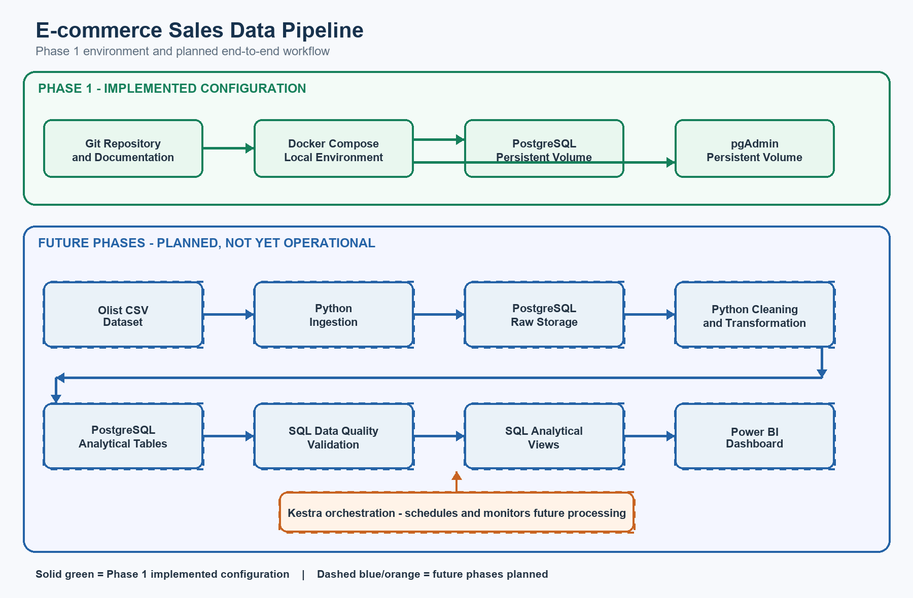

# End-to-End Architecture

## Status legend

- **Green, solid:** platform implemented during Phase 1.
- **Blue, dashed:** data path implemented during Phases 2 and 3; the original diagram predates that implementation.
- **Orange, dashed:** planned orchestration; Kestra is not installed.

The editable original proposal diagram is in `architecture.mmd`. Phases 2 and 3 now implement the CSV-to-raw-to-clean-to-warehouse-to-view path; Kestra and Power BI remain future work.

## Phase 1 - implemented

| Component | Purpose | Evidence |
|---|---|---|
| Git repository structure | Versioned documentation and reserved project directories | Repository files and initial commit |
| Docker Compose | Defines the local PostgreSQL and pgAdmin services | `docker-compose.yml` |
| PostgreSQL | Future raw and analytical storage platform | Container definition, health check, named volume |
| pgAdmin | Browser-based PostgreSQL administration | Container definition, persistent settings volume, predefined server |

The environment definition and live runtime were validated on this workstation with Docker Desktop 4.99.0, Docker Engine/CLI 29.9.3, and the WSL 2 backend. `docker compose config` passed; both containers reached healthy status; PostgreSQL accepted a query; pgAdmin returned HTTP 200, imported its predefined server, and connected visibly to PostgreSQL. See `environment_validation.md` for the captured evidence.

## Phases 2 and 3 - implemented

1. A Python one-shot container reads and validates the nine unmodified Olist CSV files.
2. PostgreSQL stores unchanged parsed source values and ingestion lineage in `raw_data`.
3. A second one-shot container executes safe type conversion and documented business rules into `clean_data`.
4. Rejected records and baseline quality metrics remain auditable by transformation run.
5. `warehouse` contains conformed dimensions and an order-item-grain fact table.
6. Transaction guards validate fact row/revenue and geolocation occurrence reconciliation.
7. `analytics` views expose category, monthly trend, and customer-state reporting without one-to-many inflation.

## Future phases - planned

1. Phase 4 adds configurable automated quality gates around the existing evidence.
2. Phase 5 uses Kestra to schedule and monitor ingestion, transformation, and validation.
3. Phase 6 connects Power BI to the analytical views.

## Design decisions

- **PostgreSQL is the system of record.** Separate raw, clean, warehouse, and analytical schemas provide traceability without modifying source files.
- **The analytical grain is one order item.** This supports product and seller analysis while keeping revenue at the source `price` grain.
- **Delivered orders are the primary completed-sales population.** Other statuses may be shown separately but are excluded from the main revenue measures.
- **Revenue is not derived by joining payments to order items.** Both tables can contain multiple rows per order; joining them directly can multiply values.
- **Containers are local and reproducible.** Named volumes retain PostgreSQL and pgAdmin state across normal stops and container recreation.
- **Phase boundaries are explicit.** Ingestion and the star schema are implemented; configurable quality gates, Kestra, and Power BI are not presented as operational.

## Runtime and connectivity

Both services share `ecommerce_network`. From the host, PostgreSQL is available on the configured host port (default `5432`) and pgAdmin on `http://localhost:5050`. From pgAdmin, the database host is the Compose service name `postgres`, never `localhost`.

The predefined pgAdmin entry uses the `.env.example` defaults (`ecommerce_db` and `ecommerce_user`) and prompts for the database password. If those two values are changed, update or recreate the pgAdmin server registration.
