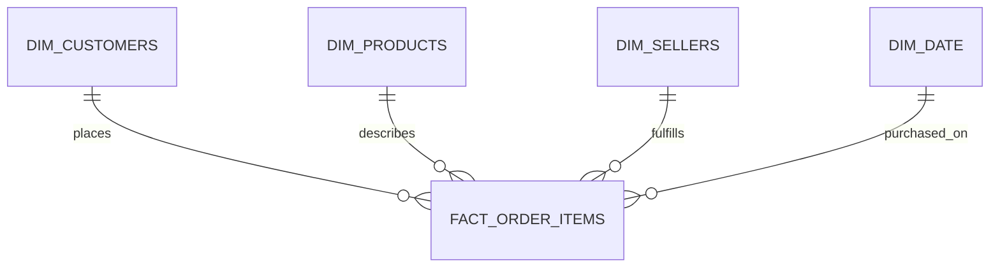

# Conceptual Analytical Database Design

## Scope

This is a Phase 1 design artifact. The tables below are proposed only; they are not created or populated in this phase. The model has been checked against the verified source profile, but its physical implementation and loading remain later-phase work.

## Fact-table grain

`fact_order_items` represents **one product line within one order**, uniquely identified in the source by the candidate composite key (`order_id`, `order_item_id`). It does not represent an entire order. An order containing three items produces three fact rows.

`item_price` maps to `olist_order_items_dataset.price`. Freight is stored separately in `freight_value` and excluded from the primary product-sales revenue measure. Primary completed-sales queries filter `order_status = 'delivered'` and use the order purchase timestamp for the purchase date.

## Entities and proposed columns

### `dim_customers`

| Column | Proposed type | Key | Source / rule |
|---|---|---|---|
| `customer_key` | BIGINT | PK | Warehouse surrogate key |
| `customer_id` | TEXT | Alternate key | Customers `customer_id`; order-level customer reference |
| `customer_unique_id` | TEXT | Non-unique business identifier | Customers `customer_unique_id`; can recur across orders |
| `customer_city` | TEXT |  | Customers `customer_city`, standardized conservatively |
| `customer_state` | CHAR(2) |  | Customers `customer_state`; expected Brazilian state code |

The source `customer_id` is expected to identify an order-specific customer record, while `customer_unique_id` represents the person-level identifier across orders. Both are retained to avoid collapsing distinct source records prematurely.

### `dim_products`

| Column | Proposed type | Key | Source / rule |
|---|---|---|---|
| `product_key` | BIGINT | PK | Warehouse surrogate key |
| `product_id` | TEXT | Alternate key | Products `product_id` |
| `product_category_name` | TEXT |  | Original Portuguese category |
| `product_category_name_english` | TEXT |  | Left join to category translation |

Missing product categories or missing translation matches map to an explicit `Unknown` member rather than dropping order items.

### `dim_sellers`

| Column | Proposed type | Key | Source / rule |
|---|---|---|---|
| `seller_key` | BIGINT | PK | Warehouse surrogate key |
| `seller_id` | TEXT | Alternate key | Sellers `seller_id` |
| `seller_city` | TEXT |  | Sellers `seller_city` |
| `seller_state` | CHAR(2) |  | Sellers `seller_state` |

### `dim_date`

| Column | Proposed type | Key | Source / rule |
|---|---|---|---|
| `date_key` | INTEGER | PK | Calendar key in `YYYYMMDD` form |
| `full_date` | DATE | Alternate key | Complete calendar date |
| `day` | SMALLINT |  | Day of month |
| `month` | SMALLINT |  | Month number |
| `quarter` | SMALLINT |  | Calendar quarter |
| `year` | SMALLINT |  | Calendar year |

### `fact_order_items`

| Column | Proposed type | Key | Source / rule |
|---|---|---|---|
| `order_item_key` | BIGINT | PK | Warehouse surrogate key |
| `order_id` | TEXT | Degenerate dimension | Order items `order_id` |
| `order_item_id` | INTEGER | Source line identifier | Order items `order_item_id` |
| `customer_key` | BIGINT | FK | Orders -> customers -> `dim_customers` |
| `product_key` | BIGINT | FK | Order items -> `dim_products` |
| `seller_key` | BIGINT | FK | Order items -> `dim_sellers` |
| `purchase_date_key` | INTEGER | FK | Date portion of orders `order_purchase_timestamp` |
| `item_price` | NUMERIC(12,2) | Measure | Order items `price` |
| `freight_value` | NUMERIC(12,2) | Measure | Order items `freight_value`; separate from sales revenue |
| `order_status` | TEXT |  | Orders `order_status` |

A unique constraint on (`order_id`, `order_item_id`) is proposed in addition to the surrogate primary key.

## Relationships

Each fact row references exactly one customer, product, seller, and purchase date after unknown-member handling. Each dimension row can relate to many order items.

## Source-to-target mapping

| Target | Required source files | Join path |
|---|---|---|
| Customer attributes and key | Customers, Orders | `order_items.order_id = orders.order_id`; `orders.customer_id = customers.customer_id` |
| Product attributes and key | Order Items, Products, Translation | `order_items.product_id = products.product_id`; category name to translation |
| Seller attributes and key | Order Items, Sellers | `order_items.seller_id = sellers.seller_id` |
| Purchase date and order status | Orders | `order_items.order_id = orders.order_id` |
| Item price and freight | Order Items | Direct, no aggregation before loading |

## Duplicate and missing-reference strategy

- Measure candidate-key duplication during source profiling before deciding any deduplication rule.
- Reject exact duplicate source rows into an auditable exception path in a future phase; never silently delete conflicting records.
- Resolve duplicate dimension business keys deterministically only after comparing all attribute values.
- Create one surrogate `Unknown` row in each dimension for missing or unmatched references so facts remain countable.
- Preserve original identifiers to support reconciliation and reprocessing.
- Do not join geolocation directly into the first star schema: postcode prefixes are not necessarily unique and can multiply facts. Geographic coordinates require a separately deduplicated mapping design.

## Analytical safeguards

- `SUM(item_price)` is the primary product-sales revenue measure; freight is excluded unless explicitly added and labeled.
- `COUNT(DISTINCT order_id)` is the order-volume measure.
- Main measures filter to `order_status = 'delivered'`.
- Monthly grouping uses the date from `order_purchase_timestamp`, not delivery date.
- State analysis uses `dim_customers.customer_state`.
- Payments and reviews are intentionally outside the initial fact table. Directly joining either one-to-many dataset to order items could inflate revenue.
- A future reconciliation test will compare item totals before and after dimension joins and count unmatched keys.
