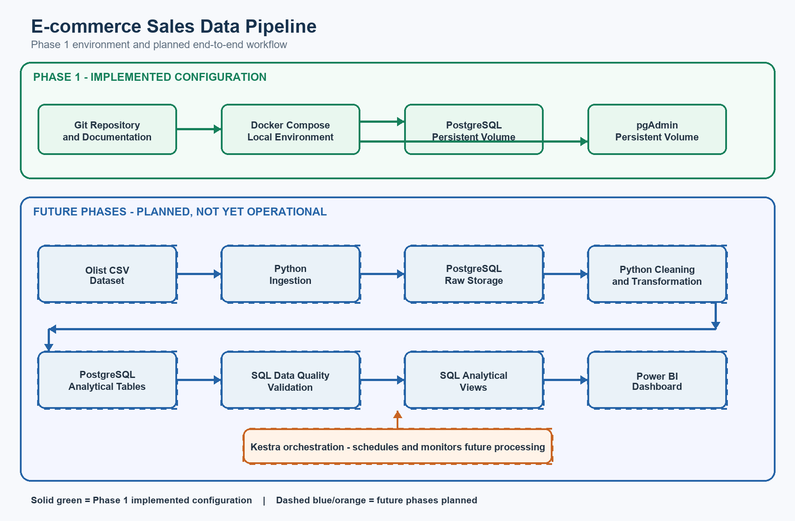

# E-commerce Sales Data Pipeline

## Phase 1: Project Proposal and Environment Setup

| Submission field | Value |
|---|---|
| Course | Data Engineering |
| Submission date | [Insert submission date] |
| Institution | [Insert university / department] |

### Team members and roles

| Student | University ID | Proposed role |
|---|---|---|
| Student 1 - Name | ID | Project coordination / data engineering |
| Student 2 - Name | ID | Database design / SQL |
| Student 3 - Name | ID | Docker / orchestration |
| Student 4 - Name | ID | Analytics / documentation |

> Replace every placeholder before submission. No student identity has been invented.

---

## 1. Introduction

E-commerce platforms produce related but independently stored records for customers, orders, products, sellers, payments, shipping, and reviews. Although these records originate from the same business process, storing them in separate files makes consistent analysis difficult. Reliable reporting requires explicit grains, repeatable joins, quality controls, and a managed analytical store.

This project proposes a local, reproducible data engineering pipeline around the Olist Brazilian E-Commerce Public Dataset. The complete future solution will ingest source CSV files, preserve raw records, clean and validate them, build analytical tables in PostgreSQL, and expose views for a Power BI dashboard. Kestra will later orchestrate the processing steps. Phase 1 is intentionally limited to proposal development, dataset and schema planning, repository initialization, and a Docker Compose environment for PostgreSQL and pgAdmin.

## 2. Problem statement

E-commerce platforms generate transactional data from customers, orders, products, sellers, and payments. These datasets are often distributed across multiple files, making it difficult to produce reliable and consistent business insights. Careless joins can duplicate monetary values, inconsistent definitions can change results, and manual local setup can prevent team members from reproducing one another's work.

The goal is to design and eventually implement an automated data engineering pipeline that extracts, cleans, validates, transforms, and stores e-commerce transaction data in PostgreSQL. The resulting analytical database will support reporting and business intelligence dashboards. Phase 1 establishes the dataset, business questions, architecture, conceptual database, governance assumptions, and reproducible development environment required for later implementation.

## 3. Project objectives

- Select and document a public dataset exceeding 10,000 rows.
- Define three business-relevant questions with unambiguous measures and dimensions.
- Propose an end-to-end architecture while separating implemented and planned components.
- Design a conceptual star schema at a declared fact grain.
- Provide a version-controlled, student-friendly repository structure.
- Define a reproducible PostgreSQL and pgAdmin environment with persistent storage.
- Record data-quality hypotheses and a process for verified source profiling.
- Prepare a professional proposal and a 3-5 minute demonstration script.
- Leave the repository ready for Phase 2 without implementing Phase 2 prematurely.

## 4. Dataset description and source

| Dataset field | Value |
|---|---|
| Dataset | Olist Brazilian E-Commerce Public Dataset |
| Publisher | Olist |
| Source | [Kaggle dataset page](https://www.kaggle.com/datasets/olistbr/brazilian-ecommerce) |
| License shown by publisher | CC BY-NC-SA 4.0 |
| Publisher description | Approximately 100,000 anonymized orders from 2016 to 2018 across Brazilian marketplaces |

The publisher-reported order count satisfies the course requirement of at least 10,000 rows. In the present workspace, the CSV files were not available and Kaggle credentials were not configured. Therefore, the approximate size and date range are publisher statements, not locally verified profile results. The repository includes a standard-library profiler that will replace the pending report with measured counts after legitimate download.

### Expected files and structure

| Source file | Expected subject | Expected candidate key |
|---|---|---|
| `olist_orders_dataset.csv` | Order lifecycle and timestamps | `order_id` |
| `olist_order_items_dataset.csv` | Products and sellers on each order | (`order_id`, `order_item_id`) |
| `olist_customers_dataset.csv` | Order-level and unique customer identifiers, location | `customer_id` |
| `olist_products_dataset.csv` | Product category and physical attributes | `product_id` |
| `olist_order_payments_dataset.csv` | One or more payments per order | (`order_id`, `payment_sequential`) |
| `olist_order_reviews_dataset.csv` | Review scores and optional comments | To be verified |
| `olist_sellers_dataset.csv` | Seller and seller location | `seller_id` |
| `olist_geolocation_dataset.csv` | Postal-prefix coordinates | No unique key assumed |
| `product_category_name_translation.csv` | Portuguese-to-English category names | `product_category_name` |

The complete expected column-level dictionary and proposed logical types appear in `data_dictionary.md`. Actual headers, types, nulls, duplicates, and key validity remain pending source inspection in `dataset_profile.md`.

## 5. Data fields and proposed logical types

The main fields required by the three questions are:

| File | Relevant fields | Proposed logical types |
|---|---|---|
| Orders | `order_id`, `customer_id`, `order_status`, `order_purchase_timestamp` | TEXT, TEXT, TEXT, TIMESTAMP |
| Order items | `order_id`, `product_id`, `seller_id`, `order_item_id`, `price`, `freight_value` | TEXT, TEXT, TEXT, INTEGER, NUMERIC, NUMERIC |
| Customers | `customer_id`, `customer_unique_id`, `customer_state`, `customer_city` | TEXT, TEXT, CHAR(2), TEXT |
| Products | `product_id`, `product_category_name` | TEXT, TEXT |
| Translation | `product_category_name`, `product_category_name_english` | TEXT, TEXT |

Identifiers and postal prefixes will be stored as text to preserve leading zeros and avoid meaningless arithmetic. Monetary fields will use fixed-precision numeric types rather than floating point. Timestamps will be parsed explicitly and retained at timestamp precision, while the calendar dimension will use dates.

## 6. Data quality considerations and limitations

Potential issues to measure after download include missing product categories and attributes, optional review comments, missing lifecycle timestamps for incomplete orders, duplicate or conflicting keys, unmatched translation labels, and non-unique geolocation postal prefixes. Dates can also be logically inconsistent even if they parse successfully, such as a delivery time preceding purchase time.

The relational shape creates important analytical risks. An order can have multiple items, payments, and possibly review records. Joining all three directly by `order_id` can create a many-to-many multiplication and overstate sales. Geolocation can also contain more than one row per postal prefix and must be deduplicated or aggregated before enrichment. The project will preserve raw data, quantify these cases, and validate row counts and totals at every join.

The public data is anonymized and historical, so it cannot identify current customers or describe present market conditions. Revenue in this proposal is item sales value, not accounting revenue, margin, cash collected, tax, or total order value. Currency is interpreted in the dataset's Brazilian commercial context but must be labeled consistently in the dashboard.

## 7. Analytical questions

### Question 1: Which product categories generate the highest sales revenue?

**Business significance:** Identifies categories that contribute most to merchandise value and can guide merchandising, seller acquisition, inventory attention, and dashboard prioritization.

**Required source files:** Order items, orders, products, and product-category translation.

**Relevant columns:** `order_id`, `product_id`, `price`, `order_status`, `product_category_name`, and `product_category_name_english`.

**Expected aggregation:** Sum `price` by translated category after filtering to delivered orders. Freight is excluded. Missing or unmatched categories are retained as `Unknown`.

**Proposed SQL approach:** Start at order-item grain; join orders one-to-one by `order_id`, products many-to-one by `product_id`, and the deduplicated translation table many-to-one by category. Filter `order_status = 'delivered'`, group by category, calculate `SUM(price)`, and sort descending. Reconcile total price before and after descriptive joins.

**Dashboard visualization:** Ranked horizontal bar chart with category, sales revenue, percentage of total, and optional distinct-order tooltip.

### Question 2: How do monthly sales revenue and order volumes change over time?

**Business significance:** Shows seasonality, growth, contraction, and unusual periods for planning and performance review.

**Required source files:** Orders and order items.

**Relevant columns:** `order_id`, `order_status`, `order_purchase_timestamp`, and `price`.

**Expected aggregation:** For delivered orders, group by calendar month of the purchase timestamp. Calculate `SUM(price)` and `COUNT(DISTINCT order_id)`. The chosen date means the month in which the customer placed the order, even if delivery occurred later.

**Proposed SQL approach:** Join order items to orders by `order_id`, filter delivered orders, use `DATE_TRUNC('month', order_purchase_timestamp)`, sum price, and count distinct order identifiers. Build a complete month spine from `dim_date` so months with zero activity can appear explicitly.

**Dashboard visualization:** Two aligned time-series charts or a carefully labeled combination chart: revenue as a line/columns and distinct order volume as a second series.

### Question 3: Which Brazilian states contribute the most to total sales revenue?

**Business significance:** Supports regional prioritization and highlights where customer demand is concentrated. It describes customer destination geography, not seller origin.

**Required source files:** Orders, order items, and customers.

**Relevant columns:** `order_id`, `customer_id`, `order_status`, `price`, and `customer_state`.

**Expected aggregation:** For delivered orders, sum item `price` by customer state and optionally calculate distinct order count and average item revenue. Unknown states remain visible.

**Proposed SQL approach:** Join order items to orders by `order_id`, then orders to customers by `customer_id`. Filter delivered orders, group by standardized customer state, calculate `SUM(price)` and `COUNT(DISTINCT order_id)`, and reconcile against the delivered-item total.

**Dashboard visualization:** Ranked state bar chart as the primary accessible visual, with an optional filled map after geographic codes are validated.

## 8. Common analytical assumptions

- Primary product-sales revenue equals `SUM(olist_order_items_dataset.price)`.
- Freight is excluded from sales revenue and shown separately only when explicitly labeled.
- Primary completed-sales analysis includes `order_status = 'delivered'`.
- Order volume uses `COUNT(DISTINCT order_id)`.
- Monthly grouping uses `order_purchase_timestamp` and calendar months.
- State attribution uses the customer's state, not the seller's state.
- Price is aggregated from order-item grain; payment records are not joined into these measures.
- All joins will be checked for row multiplication, unmatched keys, and total reconciliation.

## 9. Proposed system architecture

The green lane is implemented in Phase 1: Docker Compose, PostgreSQL, pgAdmin, persistent volumes, and the Git repository. The planned lane begins with the source CSVs and continues through Python ingestion, PostgreSQL raw storage, Python cleaning/transformation, PostgreSQL analytical tables, SQL data-quality validation, SQL analytical views, and Power BI. Kestra will later schedule and monitor ingestion, cleaning, loading, and validation. Dashed planned components are not operational in Phase 1.

PostgreSQL is chosen as both the raw and analytical store to keep the university project understandable and reproducible. Docker Compose provides consistent local versions and network names. The raw layer will preserve source fidelity; analytical tables will encode business rules; views will provide controlled dashboard interfaces.

## 10. Proposed conceptual database design

The proposed model is a compact star schema:

| Entity | Role | Key design |
|---|---|---|
| `dim_customers` | Customer identifiers and destination geography | Surrogate `customer_key`; retain `customer_id` and `customer_unique_id` |
| `dim_products` | Product and translated category | Surrogate `product_key`; alternate `product_id` |
| `dim_sellers` | Seller identifier and origin geography | Surrogate `seller_key`; alternate `seller_id` |
| `dim_date` | Calendar attributes | Integer `date_key`; unique `full_date` |
| `fact_order_items` | One row per order item | Surrogate `order_item_key`; unique (`order_id`, `order_item_id`) |

The fact stores customer, product, seller, and purchase-date foreign keys; source order identifiers; item price; freight value; and order status. It represents one order item, not one order. Missing references map to explicit unknown dimension members so source facts are not lost. Duplicate business keys will be quarantined or resolved only through documented deterministic rules. Full mappings and relationships are in `database_design.md`.

Payments and reviews are not part of the initial fact table because their grains differ. A later design may introduce separate fact tables or order-grain aggregates. Geolocation will not be directly joined until a unique mapping strategy is established.

## 11. Technology stack

| Technology | Purpose |
|---|---|
| Git and GitHub | Collaboration, change history, and submission repository |
| Docker Compose | Reproducible local environment and service networking |
| PostgreSQL 17.12 | Planned raw storage, analytical tables, quality queries, and views |
| pgAdmin 4 9.19 | Browser-based administration and connectivity demonstration |
| Python 3 | Planned ingestion, validation, and transformation |
| SQL | Schema implementation, checks, aggregations, and analytical views |
| Kestra | Future orchestration, scheduling, retries, and monitoring |
| Power BI | Future interactive dashboard |
| Mermaid | Version-controlled architecture diagram source |

No Kafka, Spark, Airflow, or cloud platform is introduced because the dataset and course objectives do not require that complexity.

## 12. Phase 1 environment setup

The Compose file pins `postgres:17.12-alpine3.23` and `dpage/pgadmin4:9.19.0`, exposes host ports 5432 and 5050 by default, defines a shared bridge network, and uses named volumes for both services. PostgreSQL has a readiness health check. pgAdmin waits for PostgreSQL to be healthy and has its own HTTP health check. A predefined server uses service host `postgres`, internal port 5432, database `ecommerce_db`, and the default example username while requesting the password interactively.

All credentials are supplied through environment variables. `.env.example` contains development placeholders, while `.env` and raw datasets are excluded from Git. Normal `docker compose down` preserves volumes; destructive volume removal is documented but requires deliberate team action.

At creation time, Docker was unavailable on the workstation, so the Compose runtime, browser interface, and live database connection could not be truthfully certified. Static configuration and reproducible verification commands are provided for the team to execute after installing Docker Desktop.

## 13. Reproducibility plan

Each member will clone the repository, copy `.env.example` to `.env`, choose local passwords, run `docker compose config`, start the services, wait for healthy status, and execute a database query. They will access pgAdmin through port 5050 and connect to host `postgres`. Raw data will be downloaded independently from the official Kaggle source and placed under ignored `data/raw/` with unchanged filenames. The profiling script will then generate measured metadata.

The pinned container tags, named volumes, documented ports, health checks, and explicit commands reduce machine-to-machine differences. Git excludes secrets, local state, and source data while retaining every configuration and documentation artifact needed to reproduce Phase 1.

## 14. Future implementation roadmap

| Phase | Planned outcome | Not implemented in Phase 1 |
|---|---|---|
| Phase 2 | Legitimate dataset acquisition, verified profiling, raw ingestion | Python ingestion and raw tables |
| Phase 3 | Cleaning, type enforcement, and conformed dimensions | Transformation code and star schema |
| Phase 4 | Automated validations and reconciliations | Quality framework and exception handling |
| Phase 5 | Kestra scheduling, retries, and monitoring | Orchestration services and flows |
| Phase 6 | Analytical views, Power BI dashboard, final evaluation | Dashboard and production reporting |

The sequence may be aligned with the instructor's formal phase names. Every later deliverable will preserve the Phase 1 definitions unless a documented revision is approved.

## 15. Phase 1 deliverables and acceptance criteria

| Deliverable | Acceptance criterion | Status at generation |
|---|---|---|
| Proposal | Markdown and readable PDF cover required topics | Complete; team placeholders remain |
| Dataset documentation | Source, expected structure, limitations, and honest profile status | Complete; measured profile pending CSVs |
| Analytical questions | Business meaning, fields, aggregation, SQL, visual | Complete |
| Architecture | Mermaid source and rendered image; status distinction | Complete |
| Database design | Grain, keys, relationships, mappings, assumptions | Complete |
| Repository | Clean folders, ignore rules, initial commit | Complete locally |
| Environment | Compose definitions, health checks, network, volumes | Configured; runtime validation pending Docker |
| Video preparation | Timed script and checklist | Complete; recording pending |

## 16. Risks and mitigation

| Risk | Impact | Mitigation |
|---|---|---|
| Kaggle access unavailable | Profiling and ingestion cannot proceed | Manual authenticated download; never fabricate or commit source data |
| One-to-many joins inflate revenue | Incorrect conclusions | Declare grains, aggregate safely, and reconcile totals |
| Missing dimension references | Lost fact rows | Unknown members and unmatched-key reports |
| Docker or port conflicts | Team setup failure | Prerequisite checks, configurable host ports, troubleshooting guide |
| Credential exposure | Security and repository contamination | `.env` ignore rules, placeholders, no stored DB password in pgAdmin registration |
| Scope expansion | Later phases implemented inconsistently | Explicit phase boundaries and planned-only labels |

## 17. References

1. Olist. *Brazilian E-Commerce Public Dataset*. Kaggle. https://www.kaggle.com/datasets/olistbr/brazilian-ecommerce

2. Docker. *Postgres Official Image*. https://hub.docker.com/_/postgres

3. pgAdmin Development Team. *Container Deployment*. https://www.pgadmin.org/docs/pgadmin4/latest/container_deployment.html

4. Docker. *Control Startup and Shutdown Order in Compose*. https://docs.docker.com/compose/how-tos/startup-order/

5. PostgreSQL Global Development Group. *PostgreSQL Documentation*. https://www.postgresql.org/docs/

6. Mermaid. *Flowchart Syntax*. https://mermaid.js.org/syntax/flowchart.html

---

**Submission note:** Replace team, institution, course, and date placeholders; download and profile the dataset; validate Docker on a machine with Docker Desktop; record the walkthrough; and connect/push the GitHub remote before final submission.
